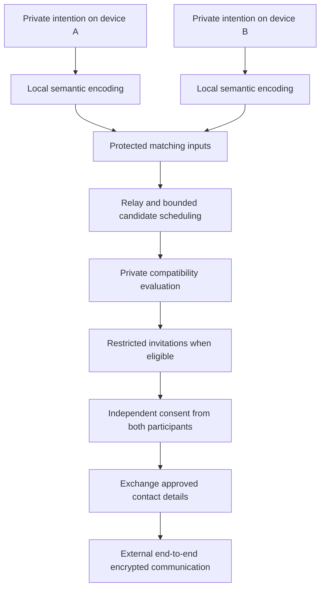

# PPSR

### Privacy-preserving semantic rendezvous

**private intent, mutual discovery**

Discover compatible people without asking a discovery operator to read their private intentions. Share contact information only after both participants agree.

**Research proposal · RFC-0001 · Draft v0.3 · October 2026**

[中文介绍](README.zh-CN.md) · [Read the full RFC](docs/rfcs/0001-private-semantic-rendezvous.md) · [Research roadmap](docs/ROADMAP.md) · [Contribute](CONTRIBUTING.md)

## The idea

A provider and a seeker describe what they offer or need in their own words. Each device encodes that description locally. A privacy-preserving computation layer evaluates compatibility over protected inputs and, when appropriate, delivers a restricted invitation. Contact details are exchanged only after independent approval from both people.

For example, two participants might seek a compatible professional collaboration without posting their detailed requirements publicly. They need not use identical wording or select from a fixed tag catalog.

## Proposed flow

This is the intended functional flow, not a claim that its events or timing are hidden. Metadata and notification leakage remain part of the research problem.

## Design at a glance

| Component | Proposed approach |
|---|---|
| Semantic input | Free-form text encoded locally with a shared, versioned profile |
| Matching | Role compatibility, semantic similarity, and optional private constraints |
| Protected evaluation | Candidate reference profile using two independently operated MPC nodes |
| Output | Restricted, pair-specific invitations rather than public scores or rankings |
| Contact handoff | Session-bound authorization from both participants |
| Initial scope | Bounded matching pools with explicit evaluation of leakage and failure modes |

The two-operator profile depends on a non-collusion assumption. Embeddings are private inputs, not anonymous substitutes for source text. A similarity score is not a calibrated probability of a valid match.

## Current status

This repository contains a **research proposal and evaluation plan**. It does not yet contain a cryptographic implementation, benchmark results, a security proof, or an independent audit. There is no runnable application or installation procedure.

PPSR studies how existing techniques could compose into private discovery. It does not claim a new cryptographic primitive, absolute anonymity, zero leakage, or a first-of-its-kind result. “RFC” means this project's request for comments, not standards-body endorsement.

The scope is discovery before contact. Payment, settlement, messaging, and verification of participant truthfulness are outside it. Early experiments should use synthetic or appropriately consented, non-sensitive material.

## Research priorities

1. Establish a semantic baseline with hard negatives, multilingual pairs, and measured thresholds.
2. Compare protected computation against that same baseline.
3. Evaluate probing, fabricated inputs, multiple identities, and authorization attacks.
4. Study asynchronous discovery, expiry, failure handling, and metadata leakage.
5. Seek independent review of a concrete construction and implementation.

See the [roadmap](docs/ROADMAP.md) for the evidence required at each stage.

## Read and review

- [RFC-0001](docs/rfcs/0001-private-semantic-rendezvous.md): complete architecture, equations, trust assumptions, limitations, and references.
- [Research roadmap](docs/ROADMAP.md): staged experiments and open implementation decisions.
- [Contribution guide](CONTRIBUTING.md): how to propose a correction, counterexample, or experiment.

Technical feedback is welcome through [GitHub Issues](https://github.com/BillyBiano/PPSR/issues). Particularly useful contributions include reproducible counterexamples, concrete leakage analyses, and relevant prior work.
